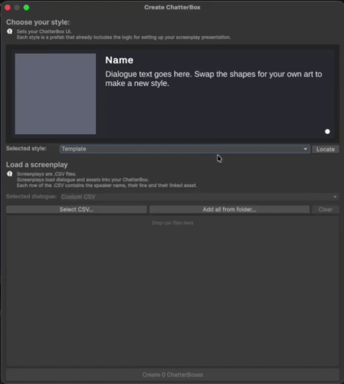
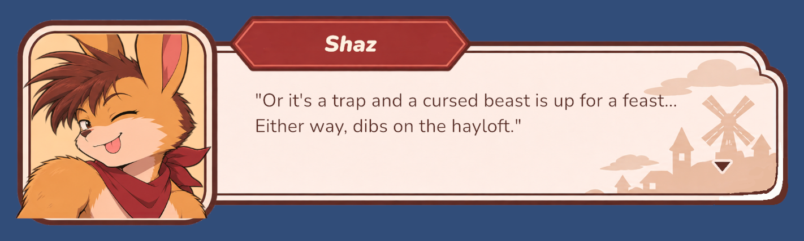
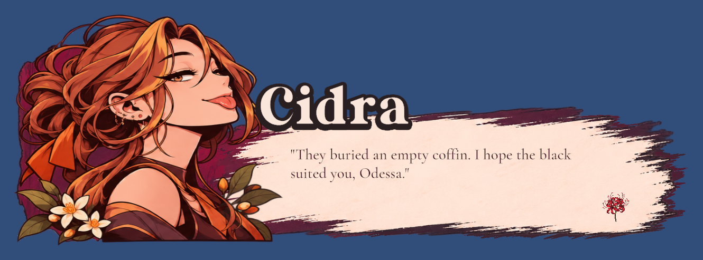
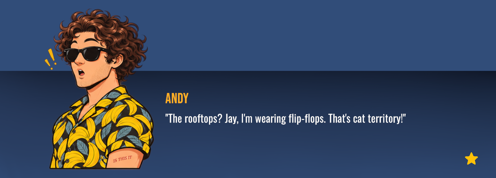
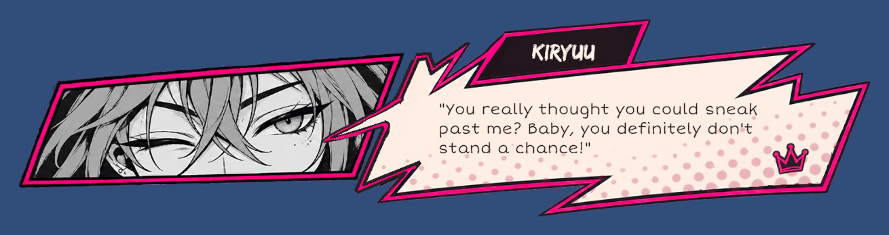
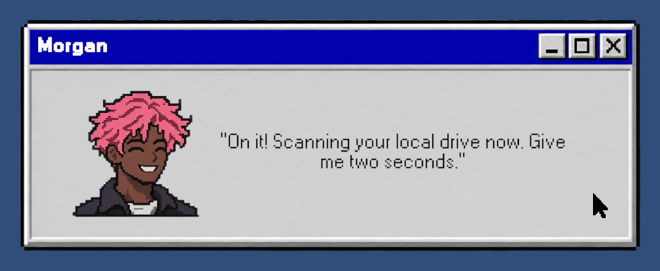
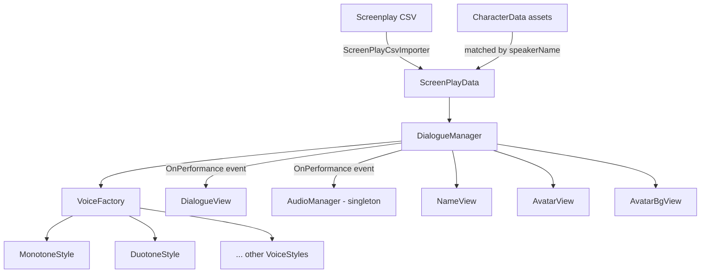

# Clapperbox

<p align="center">
  
</p>

A dialogue system toolkit for Unity, designed to automatically set up in-game dialogue scenes with minimal reliance on Unity's UI.

## Table of contents

- [About](#about)
- [Features](#features)
- [Box styles](#box-styles)
- [Getting started](#getting-started)
- [Usage](#usage)
- [Architecture](#architecture)
- [Development](#development)
- [Known issues](#known-issues)
- [Contributing](#contributing)
- [Asset notice](#asset-notice)
- [License](#license)

## About

Clapperbox is a Unity dialogue system that takes a CSV screenplay and a cast of characters, and produces a dialogue box prefab that can be dropped into a scene. It handles the timing of text reveal, voice playback, and expression changes, so you can focus on writing the story.

Clapperbox was built with the goal of relying as little as possible on Unity's UI system, so that storytellers can lose as little time as possible on UI setup and focus on their story and characters.

This dialogue system uses structured yet simple CSV files to automatically extract character data and dialogue lines, and create interactive dialogue box prefabs that can be dropped into any scene.

<!-- The system curentlt handles the timing of text reveal, voice playback, and expression changes, so you can focus on writing the story.

You can also create your own box style: the sample styles and a `Template` prefab can be duplicated and re-skinned, and any new style placed in `BoxStyles/` is picked up by the **Create Dialogue Box** tool. -->

## Features

- **Premade Samples**: 5 premade box styles, each with a sample screenplay and cast, plus a `Template` for creating your own.
- 🧩 **Pluggable speech behaviours** — a `VoiceFactory` maps a `VoiceType` enum to a `VoiceStyle` class (Monotone, Duotone, FullWord, Intro).
- 📝 **Typewriter text effect** — progressive character reveal via coroutine.
- 😀 **Expression system** — an expression is the name of a sprite in the character's `Expressions/` folder (`Happy.png` is `Happy`, `Angry-more.png` is `Angry-more`), so new expressions need no code changes. Names match regardless of case.
- 📥 **CSV import** — `NAME,EXPRESSION,LINE` rows (handles quoted commas), imported from the `ScreenPlayData` inspector or the **Create Dialogue Box** tool.
- 🩹 **Missing data check** — before a box is created, **Create Dialogue Box** lists what each CSV needs but the project lacks, and creates it when you confirm:
  - a speaker with no character data gets a `Characters/<Name>/` folder copied from `Characters/0_template`, with its expressions and voice already imported
  - an expression an existing character has no sprite for gets a white placeholder, the size of the character's `Neutral` sprite, saved as `Expressions/<Expression>.png`
  - a name close to an existing one (`Nugett`, `Suprised-most`) is flagged as a possible typo with a suggestion; **Yes** fixes it in the CSV, **Not a typo** creates it as new
- 🗑️ **Clean deletes** — deleting a dialogue box prefab also deletes its screenplay, unless another box still uses it. Character data is never deleted.
- 🎨 **Box styles** — sample dialogue box prefabs plus a `Template`, picked from the **Create Dialogue Box** tool.
- 🧑 **Character import** — each character's expressions and voice are imported from a fixed folder layout with one click.
- 🔊 **Per-speaker audio** — each character gets a voice clip and voice type, played through a singleton `AudioManager`.
- 🖼️ **Speaker theming** — name colour and background tint driven by the character's data.

<!-- ## Box styles

The project contains 5 premade styles that can be used with your own dialogue and cast, plus a `Template`. A sample CSV is provided as a preview for each style in playmode.

|                                                                                                |                                                                                                                                                                                                             |
| :--------------------------------------------------------------------------------------------: | :---------------------------------------------------------------------------------------------------------------------------------------------------------------------------------------------------------: |
|     **CozyLand**<br>      |                                                            **DarkLily**<br>                                                            |
|     **PopComic**<br>      |                                                          **PunkAnime**<br>                                                           |
| **RetroSystem**<br> | **Template**<br>All the logic and objects wired up to work with the system, but no sprites or fonts assigned. Use it as a starting point (see [Creating your own box style](#creating-your-own-box-style)). | -->

## Getting started

### Prerequisites

- Unity `6000.5.6f1` or newer
- Packages (see `Packages/manifest.json`, installed automatically on first open): URP, uGUI (includes TextMesh Pro), 2D, Input System

### Run a sample

1. Open the project in Unity.
2. Open **Tools > Clapperbox > Create Dialogue Box**, pick a premade sample style, keep the **Sample CSV** option in the dropdown, and click **Create Dialogue Box**.
3. Drag the new prefab from `Assets/Clapperbox/DialogueBoxes/` into `Assets/Scenes/Clapperbox.unity` to load it in the scene.
4. Press **Play** and click the box to advance lines with `NextLine()`.

## Usage

### Authoring your own dialogue

You only write the CSV; **Create Dialogue Box** handles the rest.

1. **Write the screenplay**
   A csv template is provided in `ScreenPlays/csv_template` for you to copy and edit.
   Each row in the CSV is a dialogue line with the character's `name`, `expression` and `line`.

   ```csv
   NAME,EXPRESSION,LINE
   Nugget,Surprised,Look! An abandoned farm!
   Nima,Neutral,"The gate on my map had a crooked weathervane just like that one."
   ```

2. **Create the dialogue box**
   - Navigate to **Tools > Clapperbox > Create Dialogue Box**.
   - Choose your own or a premade style from the drop down.
   - Select **Custom CSV** to add your own screenplay CSV(s): either use the file picker or drag and drop to add one or more CSVs.
   - Before creating the box, the tool checks each CSV for missing data (see [Missing data check](#features)) and handles them automatically if you confirm.
   - Click **Create Dialogue Box** to make your dialogue box prefab.

**Each CSV produces:**

- `DialogueBoxes/<CsvName>.prefab`: dialogue box prefab to use in your scene.
- `ScreenPlays/<CsvName>_Screenplay.asset`: a scriptable object containing the imported screenplay data and its cast
- `Characters/<CharacterName>/<CharacterName>_data.asset`: a scriptable object containing the character details, properties and associated assets (if a character already exists, it is reused and not duplicated).

#### What happens under the hood

The tool reads the CSV and compares each extracted field with specific paths in the project:

- **`NAME`**: checks if there is a folder in `Characters/` with the same name (case-insensitive) to create or reuse a `CharacterData` asset. If it fails, it creates a clone of `Characters/0_template` and renames it to the character's name.
- **`EXPRESSION`**: checks if the character's `Expressions/` folder contains a sprite with the same name (case-insensitive). If it fails, it creates a white placeholder sprite with the same name in the character's `Expressions/` folder.
- **`LINE`**: extracts the speaker's line of dialogue and lists it in the `ScreenPlayData` asset. If a line is empty, it is skipped and a warning is logged.

Typos and misspellings for `NAME` and `EXPRESSION` are flagged by the tool.

<!--
  ```text
  Characters/
  └── Nugget/
      ├── Nugget_data.asset   # CharacterData: name, colour, voice, voice type, expressions
      ├── Expressions/        # Neutral.png, Happy.png, Angry-more.png ... (file name = expression name)
      └── Voice/              # voice.wav (file must be named "voice")
  ``` -->

- **Missing expression** — a white placeholder sprite named after the expression is added to the character's `Expressions/` folder, so it stands out in play mode until you replace it.

#### ScriptableObject customization

Once a dialogue box prefab is created, you can customize its ScriptableObjects in the inspector:

- **ScreenPlayData**: lines can be manually edited from the inspector or re-imported from the CSV with **Import CSV** (see [Authoring your own dialogue](#authoring-your-own-dialogue)).
- **CharacterData**: name, colour, voice and voice type can all be edited and/or reimported from the inspector with **Import Expressions From Folder** and **Import Voice From Folder** (see [What happens under the hood](#what-happens-under-the-hood)).

  The default voice style is set to `Monotone` and can be changed to any of the following voice types:

  | Voice type  | Text reveal             | Voice                                                                  |
  | ----------- | ----------------------- | ---------------------------------------------------------------------- |
  | `Monotone`  | one character at a time | one blip per character, same pitch                                     |
  | `Duotone`   | one character at a time | one blip per character, alternating pitch                              |
  | `FullWord`  | one word at a time      | one blip per word                                                      |
  | `Intro`     | whole line at once      | one blip at the start                                                  |
  | `Animalese` | one character at a time | one blip per character, pitch varies with character (work in progress) |

Creative assets can be reimported from the character's folders with **Import Expressions From Folder** and **Import Voice From Folder**.

Currently the user can customize the following data of the dialogue box:

- **Screenplay data**: write your own CSV screenplay and import it into the box (see [Authoring your own dialogue](#authoring-your-own-dialogue)).
- **Characters**: create your own characters and import their expressions and voice (see [What happens under the hood](#what-happens-under-the-hood)).

### Creating your own box style

1. **Create a folder** under `Assets/Clapperbox/BoxStyles/`, e.g. `BoxStyles/MyStyle/`.
2. **Duplicate a prefab** into it — `Template/Template_DialogueBox.prefab` for a bare start, or one of the sample prefabs to start from a finished look.
3. **Re-skin it** — swap the sprites, fonts, colours and layout. Keep the `DialogueManager` and its four views (`DialogueView`, `NameView`, `AvatarView`, `AvatarBgView`) assigned.
4. **Open Create Dialogue Box** — the style appears in the style picker. The picker lists every prefab that sits inside a sub-folder of `BoxStyles/` and contains a `DialogueManager`; prefabs placed directly in `BoxStyles/` are ignored, and several prefabs in one folder show up as a sub-menu.
5. _(Optional)_ **Add a sample screenplay** — name the folder `Sample_<Name>` and add a `<Name>_sample.csv` (in the style folder or `ScreenPlays/csv/`). The tool then offers it as the style's **Sample CSV**.

## Architecture

Clapperbox separates three concerns:

**Data**
The ScriptableObjects that define:

- The dialogue data: what is said, who says it and the source of that data - the CSV
- The character data: who the speaker is and their properties (their voice and voice style, expression sprites, name and colour).

**Logic**
Everything that is in the Scripts folder, which includes:

- The dialogue manager: manages the dialogue flow and performance for each line
- The audio manager: manages the audio playback for each line
- The voice factory: decides how the data has to be presented by the managers (the timing of the text reveal, the audio playback, etc).

**View**
The MonoBehaviour objects that render the dialogue box:

- The name, the avatar and the background, which render the ScriptableObject data based on the logic from the managers and the voice factory.

### Tech stack

- **Unity 6** with **C#**
- **Universal Render Pipeline (URP)** `17.6.0`
- **TextMesh Pro** for text rendering
- **uGUI** (`UnityEngine.UI`) for the box, avatar and background images
- **2D** packages (sprite, animation, tilemap, etc.)
- **Input System**

### Project structure

```text
Assets/
├── Clapperbox/
│   ├── BoxStyles/        # Sample styles and template prefabs used by the tool to create new dialogue boxes
│   ├── DialogueBoxes/    # Dialogue box prefabs that are created by the tool and used in the scene (one prefab per dialogue CSV)
│   ├── Characters/       # character folders: each folder contains a CharacterData asset, an Expressions/ folder and a Voice/ folder
│   ├── ScreenPlays/      # contains a folder for all your screenplay csvs and the data version created by the importer
│   ├── Fonts/            # fonts used by the sample box styles <- these might be moved to their relevant box style folders in the future
│   ├── Scripts/
│   │   ├── Voice/        # VoiceFactory and voice related classes
│   │   ├── DialogueBox/  # View logic for the dialogue box
│   │   ├── Enums/        # VoiceType, AvatarAnimationStyle
│   │   ├── Generics/     # Reusable base classes
│   │   ├── Managers/     # Manage the flow of the dialogue presentation in a scene (DialogueManager, AudioManager)
│   │   └── ScriptableObjects/ # Data assets that need to be presented in the scene
│   └── Editor/           # Tool logic that is accessed from the Unity Editor only.
├── Scenes/
└── Settings/
```

### Data flow



Per line:

1. `DialogueManager.StartLine(i)` reads the `Line` (speaker + text + expression) and looks up the speaker's `CharacterData` in the screenplay's cast.
2. Views are updated: `NameView` (name + colour), `AvatarView` (expression sprite), `DialogueView` (line text), `AvatarBgView` (background tint).
3. `VoiceFactory.CreateStyle(speaker.voiceType)` returns the matching `VoiceStyle`, which splits the text into `VoiceUnit` units (characters to reveal, pitch, tempo, sound length).
4. `DialogueManager` plays the units on a coroutine and raises `OnPerformance` for each one: `DialogueView` reveals the text and `AudioManager` plays the voice clip, cut at the unit's sound length. The style owns the _when_, so each voice type controls its own rhythm.
5. `NextLine()` interrupts the current line (`OnLineSkipped` stops the audio) and starts the next one.

### Key design patterns

- **Factory** — `VoiceFactory` selects a `VoiceStyle` from the `VoiceType` enum.
- **Strategy** — each `VoiceStyle` only describes how a line is spoken; `DialogueManager` does the timing and playback.
- **Observer** — `DialogueView` and `AudioManager` subscribe to `DialogueManager` events instead of being called directly.
- **Singleton** — `DialogueManager` and `AudioManager` share a generic `Singleton<T>` base.
- **MVC-style separation** — models (ScriptableObjects), controllers (managers), views (UI components).
- **Editor tooling** — the **Create Dialogue Box** window (style picker with preview, batch CSV import), a custom `ScreenPlayData` inspector with a CSV field + Import/Clear buttons, and folder-based expression/voice import on `CharacterData`.

## Development

Edit-mode tests live in `Assets/Clapperbox/Editor/Tests/`. Run them from **Window > General > Test Runner > EditMode**.

## Known issues

- **`Animalese` is not implemented yet.** It can be picked as a character's voice type, but `VoiceFactory` logs `Unhandled VoiceType` and the line's text and voice never play (name and avatar still update). Use another voice type for now.
- **Avatar animation states** (`Fixed`, `Float`, `Shake`, `Zoomed` in `AvatarAnimationStyle`) are defined but not wired up, so avatars stay fixed.
- **Importing from the `ScreenPlayData` inspector skips the missing data check.** A speaker with no matching `speakerName` is left out of the cast; in play mode that line logs an error and the box keeps showing the previous line until the next click. > Use **Create Dialogue Box** instead, or create the character and re-import.

## Contributing

Bug reports and questions are welcome in [GitHub Issues](../../issues).

## Asset notice

The graphics in the sample box styles and sample characters were made with generative AI and quickly edited by hand, so the samples clearly show how the tool works. They are placeholders for demonstration, not finished official art..
