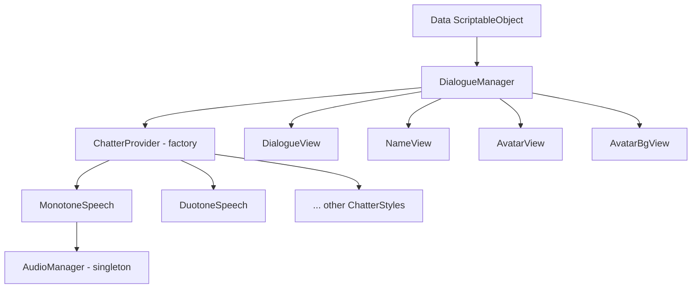

# Chatterbox 🎙️
A dialogue system toolkit for Unity, designed to automatically set up in-game dialogue scenes with minimal 

reliance on Unity's UI.

# About

Chatterbox was built to have reusable yet customizable dialogues throughout different projects at the minimal ui switching cost.
A **dialogue system toolkit** for Unity, designed to automatically set up in-game dialogue scenes through CSV files to avoid touching code or completely relying on Unity's UI.

The csv files define each dialogue line with text, expression and speaker name, which the system uses to create Character Objects with their associated assets ( which are imported automatically from a defined folder structure based on the character name) and assigned rendering style and create a dialogue object that links the lines to the character objects.

---

## What is this?

Chatterbox is an in-engine dialogue framework with three concerns cleanly separated:

| Layer      | What it does                                                                 |
|------------|------------------------------------------------------------------------------|
| **Data**   | `ScriptableObject` assets define *what* is said and *who* says it.           |
| **Logic**  | Managers and a speech-behaviour factory decide *how* it's presented.         |
| **View**   | MonoBehaviour "views" render *where* it appears (name, text, avatar, bg).    |

The core idea: **content and behaviour are decoupled**, so a creative can swap a speaker, change an expression, or re-import 100 lines of dialogue in seconds.

### Key features

- 🗂️ **Data-driven authoring** — `Data`, `DialogueData`, and `SpeakerData` ScriptableObjects, creatable from the `Assets > Create > Chatterbox` menu.
- 🧩 **Pluggable speech behaviours** — a `ChatterProvider` factory maps a `ChatterStyle` enum to a behaviour class (Monotone, Duotone, Animalese, FullWord, Intro) — Animal Crossing-style voice blips.
- 📝 **Typewriter text effect** — progressive character reveal via coroutine.
- 😀 **Expression system** — per-speaker sprite mapping keyed to an `Expression` enum (`Neutral`, `Happy`, `Sad`, `Angry`, `Surprised`) plus sprite animation states (`Fixed`, `Float`, `Shake`, `Zoomed`).
- 📥 **CSV import** — a custom `DialogueData` inspector with an "Import" button that parses `text,expression` rows (handles quoted commas).
- 🔊 **Per-speaker audio** — each speaker gets a sound clip and chatter style, played through a singleton `AudioManager`.
- 🖼️ **Speaker theming** — name colour and background tint driven by the speaker's data.

---

## How it's built

### Tech stack

- **Unity 6** (`6000.5.6f1`)
- **C#**
- **Universal Render Pipeline (URP)** `17.6.0`
- **TextMesh Pro** for text rendering
- **uGUI** (`UnityEngine.UI`) for avatar/background images
- **2D** packages (sprite, animation, tilemap, etc.)

### Project structure

```
Assets/
├── Chatterbox/
│   ├── Runtime/
│   │   ├── Data/          # ScriptableObject models: Data, DialogueData, SpeakerData
│   │   ├── Data_examples/ # Reyna sample assets + CSV
│   │   └── Scripts/
│   │       ├── ChatterTypes/  # Chatter base + speech behaviours + ChatterProvider factory
│   │       ├── Enums/         # Expression, SpriteAnimation
│   │       ├── Generics/      # Singleton<T> base class
│   │       ├── Managers/      # DialogueManager, AudioManager
│   │       └── Views/         # DialogueView, NameView, AvatarView, AvatarBgView
│   └── Editor/
│       └── DialogueImporterWindow.cs  # custom inspector + CSV import (editor-only)
├── Audio/
├── Scenes/               # SampleScene.unity
└── Settings/             # URP + input settings
```

### Architecture



**Data flow per line:**

1. `DialogueManager.ShowLine(i)` reads the `Line` (text + expression) and the `SpeakerData`.
2. Views are updated: `NameView` (name + colour), `AvatarView` (expression sprite), `DialogueView` (typewriter text), `AvatarBgView` (background tint).
3. `ChatterProvider.GetChatter(speaker.chatterStyle)` returns the matching speech behaviour.
4. The behaviour calls `AudioManager.Instance.PlaySound(speaker.sound)` — the behaviour owns the *when*, so each chatter style controls its own playback rhythm.

### Key design patterns

- **Factory** — `ChatterProvider` selects a speech behaviour from the `ChatterStyle` enum.
- **Singleton** — `AudioManager` (and a generic `Singleton<T>` base) ensure a single shared instance.
- **MVC-style separation** — models (ScriptableObjects), controllers (managers), views (UI components).
- **Editor tooling** — a custom `Editor` for `DialogueData` renders a CSV drop-field + Import/Clear buttons; a commented-out `EditorWindow` shows the path to a full drag-and-drop importer.

---

## Getting started

1. Open the project in **Unity 6** (`6000.5.6f1` or newer).
2. Open `Assets/Scenes/SampleScene.unity` — it ships wired with the Reyna example dialogue.
3. Press **Play**. Click to advance lines with `NextLine()` (or your bound input).

### Authoring your own dialogue

1. **Create the assets** via `Assets > Create > Chatterbox`:
   - `Speaker` (`SpeakerData`) — name, colour, sound, chatter style, expression sprites.
   - `Line` (`DialogueData`) — the list of dialogue lines.
   - `Data` — links a speaker to a dialogue list.
2. **Fill in dialogue** either manually in the list, or:
   - Drag a `.csv` into the `DialogueData` inspector's CSV field and hit **Import**.
   - CSV format: `TEXT,EXPRESSION` (e.g. `"Hey, how are you doing?",Neutral`). Quoted commas are supported.
3. **Wire it up** — assign the `Data` asset and the four views to the `DialogueManager` in the scene.

---

## Requirements

- Unity `6000.5.6f1`+
- Packages (see `Packages/manifest.json`): URP, TextMesh Pro, uGUI, 2D, Input System

---

## Last note — how to pitch this for the job 🎯

When presenting this project for the **Creative Developer** role at Homa, frame it with the **PAR formula** (Problem → Action → Result). This maps directly onto what the role asks for: *rapid prototyping, tools for Creative teams, and gameplay variations built fast.*

### The PAR pitch

- **P — Problem**
  Creative/UA teams needed to produce many *dialogue-driven ad concepts and playable variations* quickly. Hard-coding every line, speaker, and expression meant every new idea required a developer, so iteration was slow and content couldn't be re-skinned without touching code.

- **A — Action**
  I built **Chatterbox**, a reusable, data-driven Unity dialogue toolkit:
  - Authored content as `ScriptableObject`s so non-programmers can create and edit conversations.
  - Implemented a **factory pattern** for pluggable speech behaviours (Animal Crossing-style chatter, monotone, duotone, etc.) — a new voice style is one class, zero refactoring.
  - Built **editor tooling** (a custom inspector + CSV importer) so a full dialogue set is imported in one click instead of hand-typed.
  - Structured the code as **MVC-style views/managers/models** with singletons, a typewriter effect, and expression-driven portraits — keeping each visual/audio variation swappable.

- **R — Result**
  Dialogue scenes that previously took hours to set up per concept could now be authored and re-skinned in **minutes**, enabling high-volume A/B testing of hooks, characters, and visual styles. The toolkit is reusable across any future project, so each new creative concept starts faster than the last.

### Skills to spotlight on your CV / in interview

| Job requirement | Where it shows in this project |
|-----------------|--------------------------------|
| Strong Unity + C# | Clean architecture, design patterns, editor scripting |
| Modifying games & mechanics | Swappable speech behaviours, expression/animation states |
| Tools for Creative teams | CSV importer + ScriptableObject authoring pipeline |
| Fast prototyping / iteration | Data-driven re-skinning, pluggable behaviours |
| Player-centric mobile thinking | Typewriter pacing, per-speaker audio feedback |
| Bonus: AI-assisted workflows | Pair this system with AI-generated dialogue CSV exports for even faster concept turnaround |
